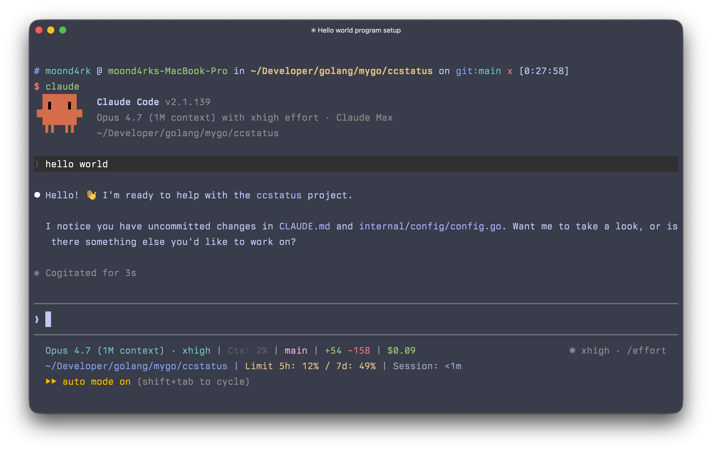

# ccstatus

[](https://github.com/moond4rk/ccstatus/actions/workflows/ci.yml) [](https://codecov.io/gh/moond4rk/ccstatus) [](https://pkg.go.dev/github.com/moond4rk/ccstatus) [](https://github.com/moond4rk/ccstatus/blob/main/LICENSE)

A customizable status line formatter for [Claude Code](https://code.claude.com/) CLI. Reads JSON session data from stdin, renders an ANSI-colored status line, and outputs to stdout.

<p align="center">
  
</p>

## Features

- Single static binary with no runtime dependencies
- 61 configurable widgets (model, tokens, context, git, cost, rate limits, prompt cache, and more)
- Custom subagent rows in Claude Code's agent panel (`subagentStatusLine`)
- Multi-line status line with flex separator layout
- Threshold colors (e.g. context % turning yellow, then red) and progress bars
- ANSI 16-color support via [fatih/color](https://github.com/fatih/color)
- Configurable via `~/.config/ccstatus/settings.json`
- Automatic Claude Code integration via `install`/`uninstall` commands

## Installation

### Homebrew

```bash
brew install moond4rk/tap/ccstatus
```

### Go

```bash
go install github.com/moond4rk/ccstatus/cmd/ccstatus@latest
```

## Quick Start

```bash
# Generate default settings
ccstatus init

# Register in Claude Code (re-run anytime to update; --subagent / --refresh N / --hide-vim-indicator optional)
ccstatus install

# Try your layout against sample data, without starting Claude Code
ccstatus preview
```

That's it. Claude Code will now display the status line after each assistant message.

## CLI Reference

```
ccstatus [flags]
ccstatus [command]
```

### Commands

| Command | Description |
| --- | --- |
| `init` | Generate default `settings.json` at the ccstatus config directory |
| `install` | Register ccstatus as the status line (and, with `--subagent`, subagent row) command in Claude Code's `settings.json` |
| `uninstall` | Remove the blocks that run ccstatus from Claude Code's `settings.json` |
| `validate` | Validate `settings.json` for correctness |
| `preview` | Render your settings against sample data (or `--input FILE`) |
| `subagent` | Render subagent rows for Claude Code's `subagentStatusLine` (Claude Code runs it) |
| `dump` | Save raw JSON input from Claude Code to a file for debugging |
| `widgets` | List all registered widget types with descriptions and default colors |
| `completion` | Generate shell autocompletion script (bash, zsh, fish, powershell) |

### Global Flags

| Flag            | Description               |
| --------------- | ------------------------- |
| `-h, --help`    | Show help for any command |
| `-v, --version` | Print version             |

### Command Details

#### `ccstatus init`

```bash
ccstatus init [--force]
```

Generates a default `settings.json` at `~/.config/ccstatus/settings.json`. Use `--force` to overwrite an existing file.

#### `ccstatus install`

```bash
ccstatus install [--subagent] [--refresh N] [--padding N] [--hide-vim-indicator]
```

Registers ccstatus in Claude Code's `~/.claude/settings.json` (or `$CLAUDE_CONFIG_DIR/settings.json`). A fresh install adds:

```json
{
  "statusLine": {
    "type": "command",
    "command": "ccstatus",
    "padding": 0,
    "refreshInterval": 30
  }
}
```

Every other key keeps its position and value, the file is replaced atomically, and a symlinked `settings.json` (for example one managed by a dotfiles repo) stays a symlink. Re-running `install` keeps the values you set by hand.

Optional flags:

- `--subagent` — also render subagent rows in the agent panel (writes `subagentStatusLine` running `ccstatus subagent`; `--subagent=false` removes it). See [Subagent Rows](#subagent-rows).
- `--refresh N` — re-run the status line every `N` seconds (writes `refreshInterval`). A fresh install uses `30` so time-based widgets (`session-clock`, `block-timer`, `prompt-cache`) and git widgets keep moving while Claude Code is idle; `--refresh 0` removes it so the status line runs only on Claude Code's events.
- `--hide-vim-indicator` — suppress Claude Code's built-in `-- INSERT --` line (writes `hideVimModeIndicator`). Set this if you use the `vim-mode` widget so the mode isn't shown twice.

#### `ccstatus uninstall`

```bash
ccstatus uninstall
```

Removes the `statusLine` and `subagentStatusLine` blocks whose command runs ccstatus. A block that runs another command is reported and left alone.

#### `ccstatus validate`

```bash
ccstatus validate
```

Checks `settings.json` for JSON errors (reported as `path:line:column`), unknown widget types, missing or duplicate widget IDs, invalid color names, out-of-range `flexMode` / `colorLevel` / `compactThreshold`, `metadata.display` values and `thresholds` the widget does not support, and widgets on the wrong kind of line (`task-*` widgets belong in `subagentLine`). Exits non-zero when any problem is found, so it works as a CI gate.

#### `ccstatus dump`

```bash
ccstatus dump [--output FILE] [--append]
```

Reads JSON from stdin (same as normal mode), saves it to a file, and renders the status line. Default output: `/tmp/ccstatus-dump.json`. Useful for inspecting what Claude Code sends. With `--append`, every invocation adds one JSON line — `{"ts", "columns", "lines", "input"}` — to `/tmp/ccstatus-dump.jsonl` (or `--output`), so a whole session can be captured.

#### `ccstatus preview`

```bash
ccstatus preview [--input FILE] [--width N] [--subagent]
```

Renders your current `settings.json` against the full sample payload from the official docs, with its timestamps moved to now, so you can try a layout without starting Claude Code. `--input` renders a payload of your own (for example a `dump` capture); `--subagent` renders `subagentLine` for a sample task list.

#### `ccstatus subagent`

```bash
ccstatus subagent
```

The `subagentStatusLine` command (set up by `ccstatus install --subagent`). Claude Code pipes the visible subagents as `{"columns", "tasks": [...]}`; ccstatus renders `subagentLine` for each task and prints one `{"id", "content"}` JSON line per row. Rows that render empty, and every row on any error, are left out so Claude Code keeps its default rendering.

#### `ccstatus widgets`

```bash
ccstatus widgets
```

Lists all registered widget types with their descriptions and default colors.

## Usage

```bash
# Default: read JSON from stdin, render status line
echo '{"model":{"id":"claude-opus-4-7","display_name":"Opus"}}' | ccstatus

# Replay captured dump data
cat /tmp/ccstatus-dump.json | ccstatus

# Preview the configured layout against sample data at 120 columns
ccstatus preview --width 120
```

## Configuration

Settings are stored at `~/.config/ccstatus/settings.json`. Edit manually to customize.

### Default Layout

A lean 2-line layout. Widgets with nothing to show — `effort`, `git-worktree`, `rate-limits` — are dropped, so a plain session collapses to `model | Ctx% | branch | +/- | $` over `cwd | Session`.

**Line 1:** `model · effort | context % | git branch + worktree | lines +/- | session cost` (context % turns yellow at 70% and red at 90%)

**Line 2:** `working directory | rate limits (5h/7d, or the gateway spend limit) | session clock`

```
Opus 4.7 (1M context) · max | Ctx: 36% | main feat-x | +12 -3 | $0.34
~/dev/myproj | Limit 5h: 3% / 7d: 12% | Session: 2h15m

Sonnet | Ctx: 12% | main | +4 | $0.05
~/dev/myproj | Session: 30m
```

To customize, edit the `lines` array in `settings.json` — e.g. swap `rate-limits` for the per-window `rate-limit-5h` (`metadata.display`: `bar`/`reset`/`full`), or add `prompt-cache` / `cache-hit-rate`. Fields you leave out of `settings.json` keep their defaults. (If line 1 is getting truncated with `...`, see `terminalWidth` below.)

### Settings Reference

```json
{
  "version": 4,
  "colorLevel": 2,
  "flexMode": "full-until-compact",
  "compactThreshold": 90,
  "defaultSeparator": "|",
  "defaultPadding": " ",
  "inheritSeparatorColors": false,
  "globalBold": false,
  "lines": [
    [
      { "id": "1", "type": "model", "color": "cyan" },
      { "id": "2", "type": "separator" },
      {
        "id": "3",
        "type": "context-percentage",
        "color": "green",
        "thresholds": [
          { "gte": 70, "color": "yellow" },
          { "gte": 90, "color": "red" }
        ]
      }
    ]
  ]
}
```

### Global Settings

| Field | Type | Default | Description |
| --- | --- | --- | --- |
| `version` | int | `4` | Config schema version |
| `colorLevel` | int | `2` | `0` disables color; any value `>= 1` enables ANSI 16-color output |
| `flexMode` | string | `"full-until-compact"` | How flex separator calculates available width |
| `compactThreshold` | int | `90` | Context % at which `full-until-compact` switches to the wider (−40 col) right margin |
| `terminalWidth` | int | (auto) | Force the status line width in columns. Leave unset/`0` to auto-detect: ccstatus reads the `COLUMNS` variable that Claude Code (v2.1.153+) sets for status line commands, then falls back to the attached terminal, then 80. |
| `defaultSeparator` | string | `"\|"` | Separator character between widgets |
| `defaultPadding` | string | `" "` | Padding around separators |
| `inheritSeparatorColors` | bool | `false` | Separators inherit color from adjacent widget |
| `globalBold` | bool | `false` | Apply bold to all widgets |

### Widget Item Options

| Field | Type | Description |
| --- | --- | --- |
| `id` | string | Unique identifier |
| `type` | string | Widget type (see list below) |
| `color` | string | Foreground color name |
| `backgroundColor` | string | Background color name |
| `bold` | bool | Bold text |
| `prefix` | string | Text before widget output |
| `suffix` | string | Text after widget output |
| `character` | string | Special character (e.g., branch icon) |
| `rawValue` | bool | Use compact/raw output mode |
| `merge` | bool/string | Join this widget to the next one without `defaultPadding` (`true`, or the legacy `"no-padding"`) |
| `metadata` | object | Widget-specific metadata, such as `display` and `barWidth` |
| `thresholds` | array | Restyle a numeric widget by value: `[{ "gte": 70, "color": "yellow" }, { "gte": 90, "color": "red", "bold": true }]`. The highest `gte` reached wins; below the first, `color` applies. Each entry may set `color`, `backgroundColor`, `bold` |

Thresholds work on widgets that render a number: the context and remaining percentages, `cache-hit-rate`, the rate-limit widgets (`rate-limits` uses the highest of its limits), `spend-limit`, `prompt-cache` (minutes until cold, or the hit percentage in `hit` mode), `session-cost`, `context-length`, and the token counts. `ccstatus validate` flags thresholds on any other widget.

### Flex Modes

| Mode | Description |
| --- | --- |
| `full` | Terminal width - 10 characters |
| `full-minus-40` | Terminal width - 40 characters |
| `full-until-compact` | Terminal width - 10, switching to - 40 once context % >= `compactThreshold` (default) |

### Subagent Rows

With `ccstatus install --subagent`, Claude Code runs `ccstatus subagent` for the agent panel below the prompt, and each subagent row renders `subagentLine` — one row of widget items, configured like a line in `lines`. When `subagentLine` is absent, this default applies:

```json
"subagentLine": [
  { "id": "s1", "type": "task-name", "color": "cyan" },
  { "id": "s2", "type": "task-status" },
  { "id": "s3", "type": "task-elapsed" },
  { "id": "s4", "type": "separator" },
  { "id": "s5", "type": "task-model" },
  { "id": "s6", "type": "task-tokens" },
  { "id": "s7", "type": "task-context", "thresholds": [{ "gte": 70, "color": "yellow" }, { "gte": 90, "color": "red" }] },
  { "id": "s8", "type": "task-sparkline" },
  { "id": "s9", "type": "separator" },
  { "id": "s10", "type": "task-label" }
]
```

```
reviewer running 1m23s | Sonnet 5.5 45.2k 23% ▁▁▂▃▄▅▆█ | Reading internal/auth/session.go
Explore completed | Haiku 5.5 18.4k 9% ▂▄▆█ | Find every caller of Session.Refresh
```

Rows are sized to the width Claude Code reports, with no flex-mode margin. `subagentLine` takes the `task-*` widgets plus `separator`, `flex-separator` and `custom-text`; `ccstatus validate` flags anything else, and `task-*` widgets on the main lines. Try it with `ccstatus preview --subagent`.

### Available Colors

8 basic: `black`, `red`, `green`, `yellow`, `blue`, `magenta`, `cyan`, `white`

8 bright: `brightBlack`, `brightRed`, `brightGreen`, `brightYellow`, `brightBlue`, `brightMagenta`, `brightCyan`, `brightWhite`

## Available Widgets

| Widget | Source | Description | Default Color |
| --- | --- | --- | --- |
| `model` | JSON | Current Claude model name | cyan |
| `version` | JSON | Claude Code version | white |
| `session-id` | JSON | Session ID (8-char short) | white |
| `session-name` | JSON | Session name (`--name` / `/rename`, or the AI-generated title) | white |
| `session-cost` | JSON | Session cost in USD | green |
| `session-clock` | JSON | Session duration | white |
| `output-style` | JSON | Output style name | white |
| `git-branch` | Git | Current branch name | magenta |
| `git-changes` | Git | Uncommitted changes count | yellow |
| `git-worktree` | Git | Worktree name | magenta |
| `tokens-input` | JSON | Input tokens in current context, incl. cache (~= `context-length` since CC v2.1.132) | white |
| `tokens-output` | JSON | Output tokens from the most recent API response | white |
| `tokens-cached` | JSON | Cached tokens | white |
| `tokens-total` | JSON | Tokens currently in the context window (in + out) | white |
| `current-usage-input` | JSON | Current round input tokens | white |
| `current-usage-output` | JSON | Current round output tokens | white |
| `cache-creation` | JSON | Cache creation tokens | white |
| `context-length` | JSON | Context usage in tokens | white |
| `context-percentage` | JSON | Context usage % (`metadata.display`: `bar` for `▓▓▓░░░░░░░ 32%`) | white |
| `context-percentage-usable` | JSON | Usable context % (heuristic: 80% of max, leaving auto-compact headroom; `bar` display) | white |
| `remaining-percentage` | JSON | Remaining context % (`bar` display) | white |
| `cache-hit-rate` | JSON | Session prompt cache hit ratio (`prompt_cache.hit_ratio`; older Claude Code: the last request's cache reads; `bar` display) | cyan |
| `prompt-cache` | JSON | Prompt cache state, e.g. `warm 42m` / `cold` — green while warm, dim once cold (`metadata.display`: `status`/`ttl`/`hit`/`misses`/`full`, e.g. `warm 42m · 91% hit · 2 misses (tools_changed)`) | green |
| `api-duration` | JSON | API response time | white |
| `block-timer` | JSON/JSONL | 5-hour block timer (uses the rate-limit window when available) | white |
| `rate-limits` | JSON | Combined limits, e.g. `5h: 3% / 7d: 12%` or `spend: $314.12/$500.00` behind a Claude apps gateway (each shown only when present) | yellow |
| `spend-limit` | JSON | Claude apps gateway spend limit, e.g. `$314.12 / $500.00` (`63%` until the dollar amounts arrive; `metadata.display`: `amount`/`percent`/`bar`/`reset`/`full`) | yellow |
| `rate-limit-5h` | JSON | 5-hour rate-limit usage (`metadata.display`: `percent`/`bar`/`reset`/`full`; `metadata.barWidth`) | yellow |
| `rate-limit-7d` | JSON | 7-day rate-limit usage (`metadata.display`: `percent`/`bar`/`reset`/`full`; `metadata.barWidth`) | yellow |
| `current-working-dir` | JSON | Current directory | blue |
| `project-dir` | JSON | Project root directory | blue |
| `transcript-path` | JSON | Transcript file path | white |
| `added-dirs` | JSON | Directories added via `/add-dir` (`metadata.display`: `list` for names) | blue |
| `repo` | JSON | Repository `owner/name` from the origin remote (raw: name only) | blue |
| `pr` | JSON | Open PR number + review state, e.g. `#1234 approved`, or `!1234` for a GitLab merge request; the number is an OSC 8 link when `pr.url` is present (raw: number) | cyan |
| `lines-changed` | Git | Uncommitted lines changed (+N/-M) | green |
| `lines-added` | Git | Uncommitted lines added | green |
| `lines-removed` | Git | Uncommitted lines removed | red |
| `session-lines` | JSON | Lines Claude added and removed this session (+N/-M) | green |
| `vim-mode` | JSON | Vim mode indicator | yellow |
| `agent-name` | JSON | Agent name | cyan |
| `effort` | JSON | Reasoning effort level | cyan |
| `thinking` | JSON | Extended thinking indicator | magenta |
| `fast-mode` | JSON | Fast mode indicator | yellow |
| `exceeds-200k` | JSON | Warning at 200k tokens | red |
| `terminal-width` | System | Terminal width in columns | white |
| `custom-text` | - | User-defined static text | white |
| `custom-command` | System | Shell command output | white |
| `separator` | - | Visual separator | white |
| `flex-separator` | - | Fills remaining width | - |

### Subagent Row Widgets

Usable only in `subagentLine`; each reads the task Claude Code passes for that row.

| Widget | Description | Default Color |
| --- | --- | --- |
| `task-name` | Subagent name, else its agent type | cyan |
| `task-type` | Agent type, e.g. `Explore` or a custom agent | magenta |
| `task-status` | `running` / `completed` / `failed` / `killed`, colored yellow / green / red / dim | by state |
| `task-label` | Progress summary, else the task description | white |
| `task-elapsed` | Running time of a running subagent, e.g. `1m23s` | white |
| `task-model` | Model, e.g. `Sonnet 5.5` (raw: model ID) | cyan |
| `task-effort` | Configured effort level, or a token budget such as `32k` | cyan |
| `task-tokens` | Running token count, e.g. `45.2k` | white |
| `task-context` | Tokens as % of the model's context window (`bar` display, thresholds) | white |
| `task-sparkline` | Token count over the last refresh ticks, e.g. `▁▂▄█` | cyan |
| `task-cwd` | Base name of the subagent's working directory | blue |

## How It Works

Claude Code pipes JSON session data to stdin on each update (after assistant messages, permission changes, vim mode toggles). ccstatus parses the JSON, renders widgets according to the configured layout, and outputs ANSI-colored text to stdout.

```
Claude Code  --[JSON]--> ccstatus --[ANSI text]--> status line
```

For the full JSON schema, see the [official documentation](https://code.claude.com/docs/en/statusline).

The separate [`subagentStatusLine`](https://code.claude.com/docs/en/statusline#subagent-status-lines) command works the same way per subagent row, printing JSON lines instead of text; see [Subagent Rows](#subagent-rows).

## Debugging

ccstatus never exits non-zero while rendering, because Claude Code hides the whole status line when the command fails. Problems show up in the status line instead:

- An invalid `settings.json` renders the default layout below a red `ccstatus: settings.json:LINE:COL: ...` line; run `ccstatus validate` for the full list.
- Input that is not JSON renders a single red `ccstatus: invalid input: ...` line.
- A field whose type changed in a newer Claude Code is coerced when that is unambiguous (a quoted number, a fractional epoch) or dropped otherwise, and the rest still renders; dropped fields are listed on stderr, which `claude --debug` logs.

Use `ccstatus dump` to capture the raw JSON that Claude Code sends:

```bash
# Temporarily switch to dump mode in ~/.claude/settings.json:
# "command": "ccstatus dump"            (latest payload only)
# "command": "ccstatus dump --append"   (every payload of the session, one JSON line each)

# Then inspect the captured data:
cat /tmp/ccstatus-dump.json | jq .
jq -c '{ts, columns, model: .input.model.display_name}' /tmp/ccstatus-dump.jsonl

# Replay captured data to test rendering:
ccstatus preview --input /tmp/ccstatus-dump.json
```

## References

- [Claude Code Status Line Documentation](https://code.claude.com/docs/en/statusline)
- [ccstatusline](https://github.com/sirmalloc/ccstatusline) - Original TypeScript implementation

## License

Apache License 2.0
